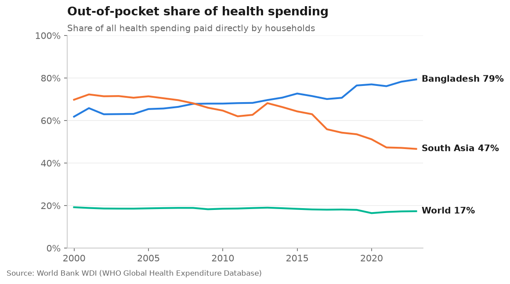

# Health Financing Benchmark: Bangladesh vs South Asia

[](https://github.com/mprantikk/south-asia-health-financing/actions/workflows/ci.yml)
[](https://github.com/mprantikk/south-asia-health-financing/actions/workflows/refresh.yml)


**Who pays for healthcare in Bangladesh, and how does that compare with the rest of South Asia?** This project benchmarks Bangladesh against its seven South Asian neighbours and the regional, lower-middle-income and world aggregates on six health-financing and outcome indicators, using **real World Bank open data**. It refreshes itself every month.

## Key numbers

<!-- KEY-NUMBERS:START -->
- Households pay **79%** of all health spending out of pocket in Bangladesh (2023), against a South Asia median of 54% and a world figure of 17%. That ranks Bangladesh **8 of 8** in the region (1 = lowest burden).
- The out-of-pocket share has moved up from 70% in 2013 to 79% in 2023.
- Government pays only **14%** of health spending (South Asia median 35%), which is the other side of the same coin.
- Total health spending is **US$54 per person** (2.2% of GDP), rank 7 of 8 in South Asia.

_Data fetched 2026-11-26._
<!-- KEY-NUMBERS:END -->

Full scorecard and charts: **[REPORT.md](REPORT.md)**



## Why this matters

When most health spending comes straight from household pockets, one hospital stay can push a family into debt, and people delay care they need. Out-of-pocket share is the single clearest measure of that risk, and it is where Bangladesh stands out.

## What it measures

| Indicator | World Bank code | Better when |
|---|---|---|
| Health spending, % of GDP | `SH.XPD.CHEX.GD.ZS` | higher |
| Health spending per person, US$ | `SH.XPD.CHEX.PC.CD` | higher |
| Out-of-pocket share of health spending | `SH.XPD.OOPC.CH.ZS` | lower |
| Government share of health spending | `SH.XPD.GHED.CH.ZS` | higher |
| Physicians per 1,000 people | `SH.MED.PHYS.ZS` | higher |
| Life expectancy at birth | `SP.DYN.LE00.IN` | higher |

Countries: Bangladesh, India, Pakistan, Nepal, Sri Lanka, Bhutan, Maldives, Afghanistan. Each country is compared on its latest available year (health-expenditure data typically lags 2–3 years).

## How it works

```
World Bank API ─► fetch (paged, retried) ─► data/health_financing.csv ─► quality checks ─► scorecard + charts
                                                                                          └─► REPORT.md, README key numbers
```

- **`hfin/fetch.py`** pulls every indicator for all countries and aggregates from the World Bank Indicators API, handling pagination and retries.
- **`hfin/checks.py`** blocks the refresh if data is duplicated, out of range, missing for Bangladesh, or stale.
- **`hfin/analysis.py`** computes latest values, the South Asia median, Bangladesh's rank (respecting whether higher or lower is better) and 10-year change.
- **`hfin/report.py`** draws the charts and writes `REPORT.md` and the key-numbers block above.
- **GitHub Actions** runs the refresh on the 1st of every month and commits any new data, so the numbers never go stale.

## Run it

```bash
git clone https://github.com/mprantikk/south-asia-health-financing.git
cd south-asia-health-financing
pip install -r requirements.txt
python -m hfin all      # fetch + checks + charts + report
pytest -v               # offline unit tests
```

## Data and licence

Data: World Bank, World Development Indicators (health expenditure series originate from the WHO Global Health Expenditure Database), licensed CC BY 4.0. Code: MIT.

Built by [Masud Parvej](https://mprantikk.github.io/).
