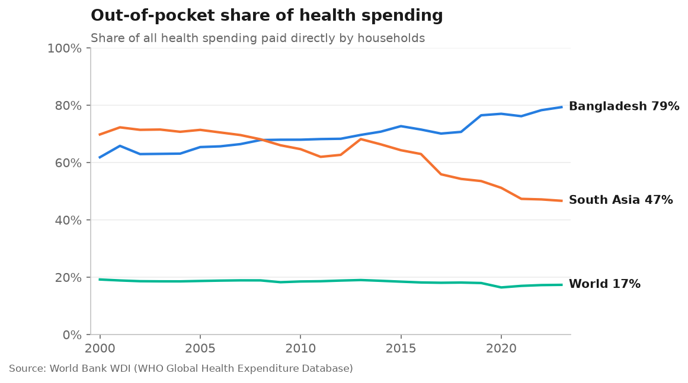
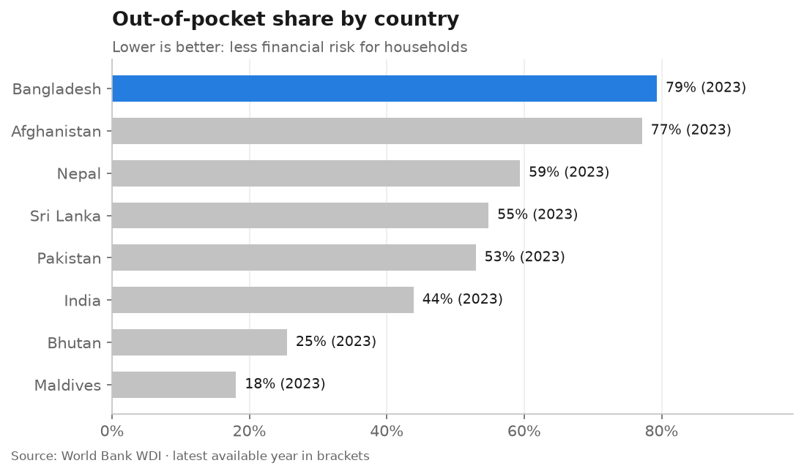
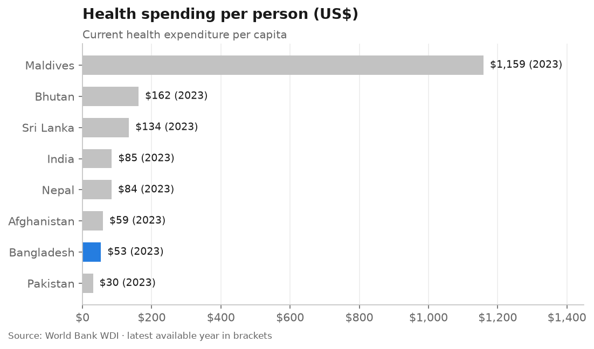

# Health financing benchmark: Bangladesh vs South Asia

_Generated automatically from World Bank open data · fetched 2026-11-26 · 1,446 values, 11 countries/aggregates, 6 indicators_

## Key findings

- Households pay **79%** of all health spending out of pocket in Bangladesh (2023), against a South Asia median of 54% and a world figure of 17%. That ranks Bangladesh **8 of 8** in the region (1 = lowest burden).
- The out-of-pocket share has moved up from 70% in 2013 to 79% in 2023.
- Government pays only **14%** of health spending (South Asia median 35%), which is the other side of the same coin.
- Total health spending is **US$54 per person** (2.2% of GDP), rank 7 of 8 in South Asia.

## Scorecard (latest available year)

| Indicator | Year | Bangladesh | South Asia median | South Asia | Lower middle income | World | Rank in South Asia |
|---|---:|---:|---:|---:|---:|---:|---:|
| Health spending, % of GDP | 2023 | 🔴 2.2 | 4.0 | 3.3 | 3.7 | 10.1 | 8 of 8 |
| Health spending per person, US$ | 2023 | 🔴 $54 | $84 | $82 | $85 | $1,317 | 7 of 8 |
| Out-of-pocket share of health spending | 2023 | 🔴 79.3 | 53.9 | 46.6 | 47.0 | 17.3 | 8 of 8 |
| Government share of health spending | 2023 | 🔴 14.5 | 34.6 | 37.3 | 36.5 | 60.9 | 7 of 8 |
| Physicians per 1,000 people | 2023 | 🔴 0.7 | 0.9 | 0.7 | 0.7 | 1.9 | 6 of 8 |
| Life expectancy at birth | 2024 | 🟢 74.9 | 72.7 | 72.6 | 69.5 | 73.5 | 3 of 8 |

🟢 better than the South Asia median · 🔴 worse. Rank 1 = best in the region for that indicator.

